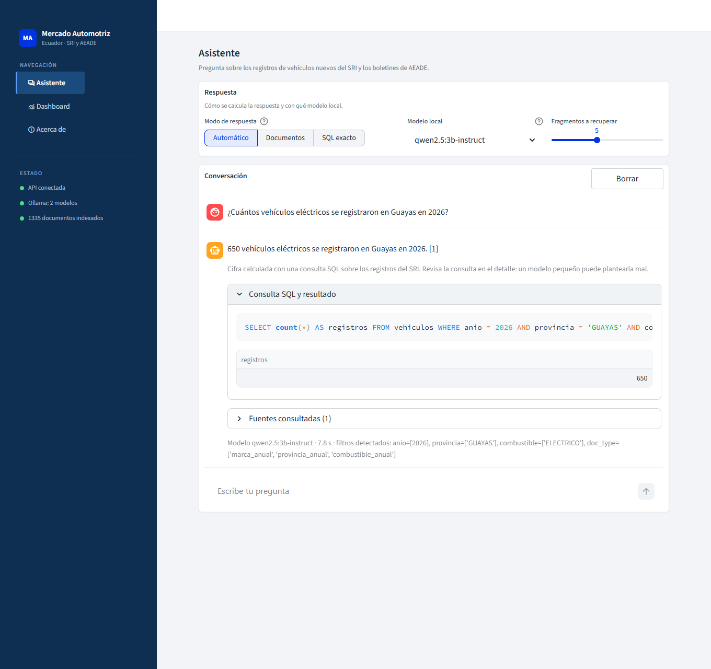
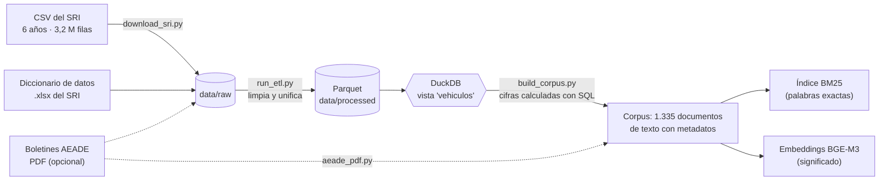
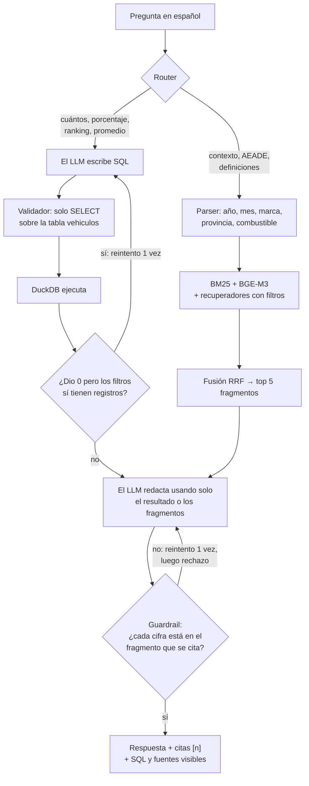
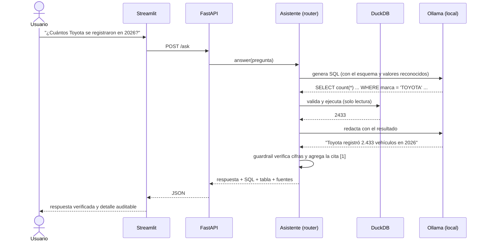
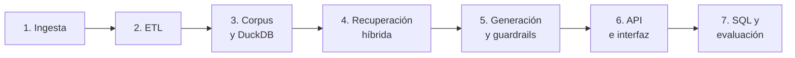
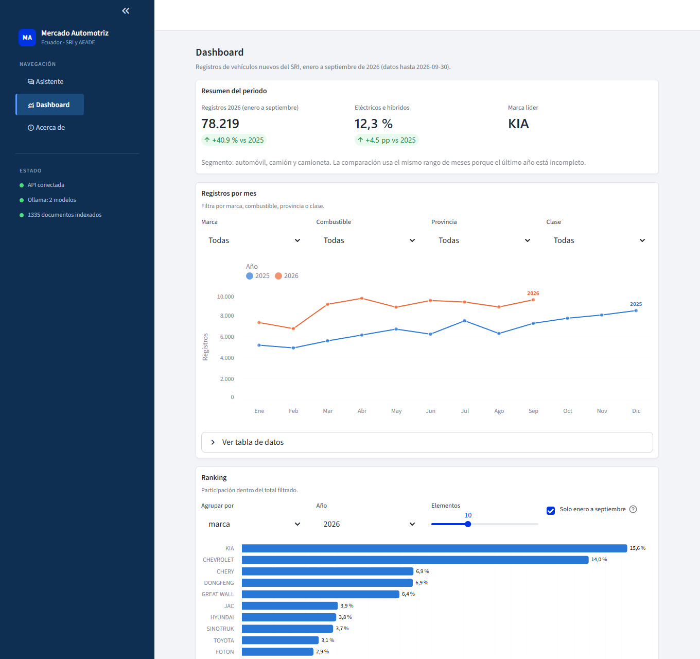

# Asistente Inteligente del Mercado Automotriz de Ecuador

> Un asistente que responde preguntas sobre el mercado de vehículos nuevos de Ecuador **con cifras exactas y fuentes
> verificables**, construido de punta a punta: desde descargar 3,2 millones de registros del SRI hasta una API y una
> interfaz web, todo corriendo **en local y sin costo** (sin APIs de pago).



**Qué vas a encontrar aquí:** un pipeline de datos reproducible, un sistema RAG con búsqueda híbrida, un agente
text-to-SQL con validación de seguridad, un guardrail anti-alucinaciones, una API REST, un dashboard, 70 tests
automáticos y una evaluación medida (con sus resultados negativos incluidos).

---

## Contenido

1. [El problema y la idea](#1-el-problema-y-la-idea)
2. [Cómo funciona (arquitectura)](#2-cómo-funciona-arquitectura)
3. [Stack tecnológico](#3-stack-tecnológico)
4. [Replícalo en tu máquina (paso a paso)](#4-replícalo-en-tu-máquina-paso-a-paso)
5. [El recorrido: qué construí en cada etapa y por qué](#5-el-recorrido-qué-construí-en-cada-etapa-y-por-qué)
6. [Evaluación y resultados](#6-evaluación-y-resultados)
7. [API y interfaz](#7-api-y-interfaz)
8. [Estructura del repositorio](#8-estructura-del-repositorio)
9. [Decisiones de diseño, límites y próximos pasos](#9-decisiones-de-diseño-límites-y-próximos-pasos)
10. [Glosario](#10-glosario)

---

## 1. El problema y la idea

El SRI publica como datos abiertos **un CSV por año con cada vehículo nuevo registrado** (marca, modelo, avalúo,
combustible, cantón...), y la AEADE (asociación de empresas automotrices) publica boletines mensuales en PDF. La
información existe, pero para contestar una pregunta como *"¿cuántos eléctricos se registraron en Guayas en 2026?"* hay
que descargar archivos de cientos de MB, limpiarlos y escribir SQL.

La idea: **que cualquiera pueda preguntarlo en español** y obtener la respuesta con su fuente.

### Por qué no basta con "conectar un LLM a los datos"

Un modelo de lenguaje es excelente redactando y muy malo contando. Si le pegas una tabla y le preguntas un total,
**inventa con seguridad**. Por eso este proyecto separa dos tipos de pregunta y usa la herramienta correcta para cada una:

| Tipo de pregunta | Ejemplo | Herramienta | Por qué |
|---|---|---|---|
| **Cantidades exactas** | "¿Qué porcentaje de los registros de 2026 fueron eléctricos?" | El LLM escribe **SQL**, DuckDB lo ejecuta | El cálculo lo hace la base de datos, no el modelo |
| **Contexto y texto** | "¿Cómo estuvo el mercado en marzo de 2026?", "¿Qué dice AEADE de los híbridos?" | **RAG**: recupera fragmentos y el LLM los resume | El conocimiento está en texto (boletines, resúmenes) |
| **Fuera de alcance** | "¿Cuántos autos usados se vendieron?" | **Rechazo explícito** | Inventar una respuesta es peor que no responder |

Y en ambos casos, un **guardrail** comprueba que cada cifra de la respuesta exista realmente en la fuente citada.

---

## 2. Cómo funciona (arquitectura)

### 2.1 Fase offline: de datos crudos a conocimiento consultable

Se ejecuta una vez (o cuando llegan datos nuevos). Cada flecha es un script de `scripts/`.



### 2.2 Fase online: qué pasa cuando haces una pregunta



### 2.3 Secuencia de una petición (API)



---

## 3. Stack tecnológico

| Capa | Herramienta | Para qué la uso | Por qué esta y no otra |
|---|---|---|---|
| Descarga | `requests` + reintentos | Bajar los CSV | Escritura atómica, idempotente y con validación |
| Almacenamiento | **Parquet** (zstd) | Datos limpios, particionados por año | 3,2 M filas en ~20 MB; lectura columnar rápida |
| Motor analítico | **DuckDB** | Consultas SQL sobre el Parquet | Sin servidor, rápido, ideal para análisis local |
| Embeddings | **BGE-M3** (sentence-transformers) | Búsqueda semántica en español | Multilingüe, gratuito, corre en local |
| Búsqueda léxica | **BM25** (implementación propia) | Marcas, modelos y cifras exactas | Sin dependencias; control de la tokenización |
| Fusión | **RRF** (Reciprocal Rank Fusion) | Combinar BM25 y semántica | No requiere calibrar escalas de puntajes |
| LLM | **Ollama** (`qwen2.5` 3B y 7B) | Escribir SQL y redactar | Gratis, local, sin enviar datos a terceros |
| API | **FastAPI** + Pydantic | Servicio REST | Validación de entrada y documentación automática |
| Interfaz | **Streamlit** + Altair | Chat y dashboard | Prototipado rápido de herramientas de analítica |
| Calidad | **pytest** (70 tests) | Regresión y seguridad | Cubre ETL, SQL, guardrails, API y UI |

---

## 4. Replícalo en tu máquina (paso a paso)

### 4.1 Requisitos

| Requisito | Detalle |
|---|---|
| Python | 3.10 o superior (probado con 3.12) |
| Espacio en disco | ~10 GB: CSV (550 MB), modelos de embeddings (2 a 4 GB), modelos de Ollama (2 a 5 GB) |
| Memoria | 16 GB recomendados (8 GB alcanzan con el modelo de 3B) |
| GPU | **Opcional.** Con una GPU de 4 GB el modelo de 3B responde en 6 a 10 s; sin GPU funciona, solo más lento |
| Ollama | https://ollama.com (gratuito) |
| Internet | Solo para la descarga inicial de datos y modelos |

> Desarrollado y medido en Windows 11 con una RTX 3050 de 4 GB y 16 GB de RAM. Los comandos de abajo usan sintaxis
> bash; en Windows PowerShell activa el entorno con `.venv\Scripts\Activate.ps1`.

### 4.2 Instalación y ejecución

**Paso 1. Clona e instala.**

```bash
git clone https://github.com/BenjaBussinessMan/rag-dashboard-app-automotive.git
cd rag-dashboard-app-automotive
python -m venv .venv && source .venv/bin/activate
pip install -r requirements.txt          # versiones exactas probadas: requirements-lock.txt
python -m pytest -q                      # 70 tests, deben pasar (no necesitan datos ni modelos)
```

**Paso 2. Descarga los datos del SRI** (6 CSV, ~550 MB, de 1 a 3 minutos).

```bash
python scripts/download_sri.py           # añade --years 2025 2026 si solo quieres esos años
```

Verás la barra de progreso por archivo y se crea `data/raw/manifest.json` con filas, fechas y huella SHA-256.

**Paso 3. Limpia y unifica (ETL a Parquet)** (~4 minutos).

```bash
python scripts/run_etl.py
```

Resultado: `data/processed/vehiculos_nuevos/` (≈20 MB), más `etl_report.json` con la calidad de cada año.
El diccionario de datos `data/raw/SRI_Vehiculos_DD.xlsx` ya viene en el repositorio.

**Paso 4 (opcional). Agrega los boletines de AEADE.**
Descarga los PDF de "Boletín de prensa" desde https://www.aeade.net/ y colócalos en `data/raw/` con el nombre
`Boletin-de-Prensa-<Mes>-2026.pdf`. No se incluyen en el repositorio por ser material de un tercero. Sin ellos el
sistema funciona igual, solo que sin las preguntas sobre AEADE.

**Paso 5. Genera el corpus de documentos** (~10 segundos).

```bash
python scripts/build_corpus.py           # por defecto 2025-2026 y automóvil/camión/camioneta
```

**Paso 6. Prueba la búsqueda.** La primera vez descarga BGE-M3 y calcula los embeddings (unos minutos).

```bash
python scripts/search.py "ventas de BYD en 2025" --no-rerank
```

**Paso 7. Instala el LLM local.**

```bash
ollama pull qwen2.5:3b-instruct          # ~2 GB, rápido
ollama pull qwen2.5:7b-instruct          # ~4,7 GB, más fiable para cifras (opcional)
```

**Paso 8. Pregunta desde la terminal.**

```bash
python scripts/ask.py "¿Cuántos vehículos eléctricos se registraron en Guayas en 2026?"
```

**Paso 9. Levanta la API y la interfaz** (en dos terminales).

```bash
python scripts/run_api.py                # http://127.0.0.1:8000   (documentación en /docs)
streamlit run app/streamlit_app.py       # http://localhost:8501
```

**Paso 10. Mide la calidad** (tarda; el modelo de 7B corre en CPU).

```bash
python scripts/run_eval.py               # recuperación, SQL y asistente completo -> docs/EVALUACION.md
```

### 4.3 Resumen de tiempos y resultados esperados

| Paso | Qué produce | Tiempo aproximado |
|---|---|---|
| 2. Descarga | 6 CSV en `data/raw/` | 1 a 3 min |
| 3. ETL | Parquet con 3.246.030 filas y 22 columnas | ~4 min |
| 5. Corpus | 1.335 documentos (`data/processed/corpus/`) | ~10 s |
| 6. Índice | Matriz de embeddings 1.335 x 1.024 (5 MB) | Unos segundos con GPU; más en CPU. Se hace una sola vez (queda en caché) |
| 8. Pregunta | Respuesta con fuentes | 3B: 6 a 10 s; 7B en CPU: 45 a 90 s |

### 4.4 Si algo falla

| Síntoma | Causa | Solución |
|---|---|---|
| `Python was not found` (Windows) | El alias de Microsoft Store intercepta `python` | Instala Python o usa un entorno conda y llama a su `python.exe` |
| Ollama devuelve error 500 con el modelo de 7B | El modelo no cabe en 4 GB de VRAM y el reparto GPU/CPU falla | Corre ese modelo solo en CPU: variable `RAG_CPU_ONLY_MODELS` (por defecto ya incluye el 7B) |
| El LLM compite con los embeddings por la GPU | VRAM insuficiente | `RAG_EMBED_DEVICE=cpu` (los embeddings del corpus ya están en disco) |
| Cambié `app/theme.py` y no se ve | Streamlit conserva el módulo en memoria | Reinicia `streamlit run` |
| "No hay CSV en data/raw" | Falta el paso 2 | Ejecuta `download_sri.py` |
| Aviso de symlinks de Hugging Face (Windows) | Windows sin modo desarrollador | Es solo un aviso; el modelo funciona igual |

### 4.5 Variables de entorno

| Variable | Efecto | Por defecto |
|---|---|---|
| `RAG_MODEL` | Modelo de Ollama que usa la API | `qwen2.5:3b-instruct` |
| `RAG_API_URL` | URL de la API que usa Streamlit | `http://localhost:8000` |
| `RAG_CPU_ONLY_MODELS` | Modelos que se ejecutan solo en CPU | `qwen2.5:7b-instruct` |
| `RAG_EMBED_DEVICE` | `cpu` para no usar la GPU en embeddings | automático |
| `RAG_RERANK` | `1` activa el reranker BGE (más lento, ~2 GB extra) | apagado |

---

## 5. El recorrido: qué construí en cada etapa y por qué

Trabajé en etapas, y cada una terminó con algo que se podía ejecutar y comprobar antes de pasar a la siguiente.



### Etapa 1. Ingesta: bajar los datos de forma robusta

**Objetivo:** descargar los CSV anuales del SRI sin corromper nada y sin repetir trabajo.
**Qué hace** `src/ingestion/sri_scraper.py`: reintentos con espera creciente, descarga en streaming a un archivo `.part`
que solo se renombra al terminar (nunca queda un archivo a medias), omite los años cerrados si el tamaño remoto no
cambió, y deja un `manifest.json` con la huella SHA-256 de cada archivo.

**Lección:** el servidor responde distinto según los encabezados. Pedir `Accept-Encoding: identity` en la consulta
`HEAD` fue necesario para que el tamaño comparado fuera el real.

### Etapa 2. ETL: unificar seis años que no son iguales

Aquí se gastó más esfuerzo del esperado. **Los seis CSV del SRI no comparten esquema:**

| Problema encontrado | Dónde | Cómo lo resolví |
|---|---|---|
| Codificación distinta | 2026 es UTF-8 con BOM; el resto latin-1 | Detección por archivo |
| Encabezados distintos | `AVALÚO` / `AVALUO`, `PAÍS` / `PAIS`, `SOCIEDAD` / `JURÍDICA` | Mapa de nombres normalizados (sin tildes, por prefijo) |
| Tres formatos de fecha | `2-dic-21`, `9/12/2024`, `20/11/2025` | Un parser común (`src/utils/dates.py`) |
| Decimales con coma | Avalúos como `1430,83` | Conversión numérica tolerante |
| Caracteres dañados | 2025 trae `ESPA?A`, `PEQUE?O` (la Ñ se perdió) | Reparaciones explícitas y conteo de `?` residuales (queda en 0) |
| Cantón en dos formas | Códigos (2021-2025) y nombres (2026) | Se cruza con el catálogo del diccionario oficial y se unifica en `canton_codigo`, `canton_nombre` y `provincia` |
| Categoría duplicada | `SOCIEDAD` y `JURIDICA` | Se unifican |

**Resultado:** un Parquet con esquema único (22 columnas) y un `etl_report.json` por año. Los casos que no se pueden
resolver quedan documentados (nombres ambiguos como `BOLIVAR` u `OLMEDO`, y un código de cantón ausente del catálogo)
en vez de adivinarse.

**Decisión:** no unir las cifras del SRI con las de AEADE. Comparé ambos y **no coinciden** (AEADE reporta 123.927
vehículos de enero a septiembre de 2026; el SRI procesado tiene 174.475 sin contar motos), así que el asistente
siempre indica de cuál fuente viene cada cifra.

### Etapa 3. DuckDB y el corpus de documentos

**Objetivo:** convertir 3,2 millones de filas en algo que un sistema de recuperación pueda usar.

Un RAG puro sobre filas tabulares no funciona: los embeddings no saben sumar. La solución fue **precalcular resúmenes
con SQL y convertirlos en texto**. Cada documento contiene cifras calculadas por DuckDB (no por un LLM), más metadatos
(`anio`, `mes`, `marca`, `provincia`, `combustible`, `fuente`):

| Tipo de documento | Cantidad | Ejemplo de lo que contiene |
|---|---|---|
| `marca_mensual` | 1.058 | Registros y avalúo mediano de una marca en un mes |
| `marca_anual` | 87 | Registros, cuota, modelos, combustibles y provincias de una marca en un año |
| `comparativo_periodo` | 51 | Mismo rango de meses entre dos años |
| `provincia_anual` | 48 | Registros, marcas líderes, % de personas jurídicas |
| `boletin_aeade` | 33 | Una página de cada boletín de AEADE |
| `mercado_mensual` | 21 | Resumen del mercado de un mes |
| `diccionario` | 20 | Definición de cada variable |
| `combustible_anual` | 11 | Registros y marcas líderes por combustible |
| `ranking` | 6 | Rankings anuales de provincias, marcas y combustibles |

**Dos trampas que evité:**
- **Años incompletos.** 2026 llega hasta el 30/09; comparar su total con 2025 completo daría un crecimiento falso.
  Los comparativos usan el *mismo rango de meses* y cada documento de un año incompleto lo avisa.
- **PDF de AEADE.** Cada tabla trae dos encabezados: uno del mes anterior (oculto) y el correcto. Indexarlo tal cual
  haría que el modelo leyera las columnas mal. `src/ingestion/aeade_pdf.py` descarta los encabezados viejos, reconstruye
  las series mensuales de los gráficos de barras y marca como poco confiables los gráficos circulares.

### Etapa 4. Recuperación híbrida

**¿Por qué híbrida?** Cada método falla donde el otro acierta:

| Método | Fortaleza | Debilidad |
|---|---|---|
| **BM25** (palabras exactas) | Un modelo (`SOLUTO`) o una cifra (`123.927`) | No entiende sinónimos ni intención |
| **Embeddings BGE-M3** (significado) | "autos eléctricos" ~ "BEV" | Se pierde con nombres propios y números |

Se combinan con **RRF** (cada documento suma `1 / (60 + posición)` en cada lista), sin tener que calibrar puntajes.

**Lo que más mejoró los resultados fue entender la consulta** (`src/retrieval/query.py`): se extraen año, mes, marca,
provincia y combustible, y se añaden recuperadores restringidos a esos metadatos. Así "BYD en 2025" ya no compite con
los 21 resúmenes mensuales de BYD. Es una señal suave: no excluye documentos que no tengan esos campos (como los PDF).

### Etapa 5. Generación con guardrails

El LLM local redacta usando solo los fragmentos recuperados. El guardrail (`src/generation/guardrails.py`) es lo que
vuelve confiable el sistema:

| Regla | Qué evita |
|---|---|
| Toda oración con cifras debe tener **todas** sus cifras en **un mismo** fragmento | Mezclar números de fuentes distintas |
| **El sistema, no el modelo, agrega la cita** `[n]` | Modelos pequeños que citan mal o no citan |
| Las oraciones sin cifras deben apoyarse en el texto del fragmento | Afirmaciones sin sustento |
| Reintento una vez con el motivo del rechazo; si falla, se rechaza | Respuestas falsas con apariencia de seguras |

**Ejemplo real del guardrail trabajando:** ante "¿cuánto crecieron las ventas entre enero y septiembre según AEADE?", un
modelo respondió `43,4 %` (una cifra que sí existe en el boletín, pero es el crecimiento de *septiembre* en vehículos livianos). La
versión inicial del guardrail la aceptaba porque la cifra estaba en algún fragmento; por eso evolucionó a verificación
**por oración y por fragmento citado**.

### Etapa 6. API e interfaz

`src/api/` expone FastAPI (con CORS y validación Pydantic) y `app/` es una interfaz Streamlit con un diseño de consola
de administración: menú lateral, tarjetas por sección, modo de respuesta seleccionable (Automático, Documentos, SQL
exacto) y un dashboard con KPIs, serie mensual y ranking. Detalle en la [sección 7](#7-api-y-interfaz).

### Etapa 7. Cifras exactas con text-to-SQL, y evaluación

**Objetivo:** que las preguntas de cantidades dejen de depender de que exista un documento con ese número.

El LLM escribe una consulta SQL y **se trata como entrada no confiable** (`src/analytics/query.py`):

| Control | Qué bloquea |
|---|---|
| Una sola sentencia que empiece por `SELECT` o `WITH` | `DROP`, `DELETE`, `INSERT`, múltiples sentencias |
| Solo la tabla `vehiculos` (o CTE propios) | Leer otras tablas, `information_schema` |
| Lista negra de funciones | `read_parquet`, `getenv`, `duckdb_*`, `COPY`, `ATTACH`... |
| Sin comentarios | Ocultar instrucciones dentro del SQL |

Tres protecciones adicionales, cada una nacida de un fallo real en la evaluación:

| Fallo observado | Protección |
|---|---|
| "¿Cuántos Kia en 2024?" devolvía "0" porque 2024 no está cargado | Si el año preguntado no está en la base, se explica el alcance |
| "¿Cuántos vehículos usados...?" devolvió una cifra inventada | El prompt declara qué no existe y el modelo responde `SIN_DATOS` |
| Un SQL con filtros contradictorios devolvía 0 con seguridad | Si el resultado es 0 pero la marca/año sí tienen registros, se pide corregirlo una vez |

La evaluación se detalla en la siguiente sección.

---

## 6. Evaluación y resultados

Medir fue tan importante como construir. Hay tres suites, todas reproducibles con `python scripts/run_eval.py`; el
informe completo se genera en [`docs/EVALUACION.md`](docs/EVALUACION.md).

### 6.1 Recuperación (50 consultas en 9 categorías)

`hit@1`: el documento correcto es el primero. `hit@5`: está entre los 5 primeros. `MRR`: media del inverso de la posición.

| Configuración | hit@1 | hit@5 | MRR |
|---|---|---|---|
| Solo BM25 | 0,52 | 0,58 | 0,555 |
| Solo embeddings | 0,68 | 0,86 | 0,755 |
| Embeddings + filtros de la consulta | 0,76 | 0,88 | 0,810 |
| Híbrida (RRF) sin filtros | 0,52 | 0,66 | 0,585 |
| **Híbrida + filtros de la consulta** | **0,82** | **0,88** | **0,848** |
| Híbrida + filtros, BM25 con la mitad de peso | 0,82 | 0,90 | 0,846 |
| Híbrida + filtros + reranker BGE | 0,82 | 0,88 | 0,844 |

**Qué aprendí de estos números:**
- La híbrida **sin** filtros (0,585) rinde peor que los embeddings solos (0,755): BM25 arrastra hacia los 1.058
  resúmenes mensuales casi idénticos. Sumar el entendimiento de la consulta la lleva a la cima.
- BM25 no sirve para casi todo (0,00 en marca anual) pero **acierta el 100 % de las consultas de término exacto**
  (modelos, cifras), donde los embeddings solos llegan a 0,44.
- El reranker (2 GB extra) **no aporta en total**: ayuda con términos exactos (0,89) pero empeora las consultas
  estructuradas (marca anual baja a 0,67). No lo activo por defecto.
- **Resultado negativo que documento:** probé aumentar el peso de BM25 cuando la consulta tiene un término raro y
  **no funcionó** (RRF premia el consenso entre listas). Retiré el código en lugar de dejarlo.

### 6.2 Text-to-SQL (31 preguntas, 6 categorías)

Exactitud de ejecución: se compara el resultado del SQL del modelo con el de una consulta de referencia escrita a mano.

| Modelo | Correctas | Tiempo por consulta |
|---|---|---|
| qwen2.5 3B (GPU) | 26/31 (84 %); con comparación estricta 24/31 | 3,5 s |
| qwen2.5 7B (CPU) | **31/31 (100 %)**; con comparación estricta 26/31 | 17,5 s |

### 6.3 Asistente completo (24 preguntas)

Incluye ruteo, SQL, documentos, guardrail y 5 preguntas que **deben rechazarse**.

| Modelo | Correctas | Detalle |
|---|---|---|
| qwen2.5 3B (GPU) | 20/24 (83 %) | SQL 8/10, documentos 4/4, AEADE 4/5, rechazos 4/5. Ruta correcta en 23/24. ~9 s por pregunta |
| qwen2.5 7B (CPU) | **22/24 (92 %)** | SQL 9/10, documentos 4/4, AEADE 4/5, rechazos 5/5. Ruta correcta en 24/24. ~60 a 90 s por pregunta |

**Cómo mejoró cada suite a lo largo del trabajo** (misma medición, antes y después de las correcciones que
describo en la etapa 7):

| Suite | Modelo | Línea base | Final |
|---|---|---|---|
| SQL, comparación estricta | 3B / 7B | 23/31 / 25/31 | 24/31 / 26/31 |
| Asistente completo | 3B / 7B | 17/24 / 19/24 | 20/24 / 22/24 |

**Lo que sigue fallando:** con el 3B, tres preguntas de cifras y una de rechazo (respondió "77.595 usados" ignorando que la
base solo tiene vehículos nuevos). Con el 7B, solo dos: "¿cuánto creció Chevrolet?" (respondió 957 unidades, la diferencia
absoluta, cuando la referencia esperaba el 9,6 %; la pregunta es ambigua) y una pregunta sobre un boletín de AEADE donde
tomó una cifra de otra tabla.

### 6.4 Conclusiones honestas

- **Para cifras exactas usa el modelo de 7B.** El de 3B escribe SQL erróneo con mucha seguridad (llegó a responder
  "100 %" de eléctricos y "7.821.899" de crecimiento). Es rápido, pero no es de fiar para números.
- **El guardrail verifica que la cifra exista en la fuente citada, no que esa fuente sea la correcta para la pregunta.**
  Es el fallo que más veces vi: el modelo toma una cifra real de otra tabla. Mitigarlo bien requeriría un verificador
  semántico (por ejemplo un NLI), que queda como trabajo futuro.
- **Mi primer set de evaluación era demasiado fácil.** Con 12 preguntas de SQL el 7B sacó 12/12; al ampliar a 31 con
  más variedad aparecieron los errores reales. Un set pequeño da falsa confianza.
- **Las reglas del parser y las del prompt se afinaron viendo los fallos de este mismo set**, así que hay algo de
  sesgo a favor. Un siguiente paso honesto es separar un set de validación que no se toque.

---

## 7. API y interfaz

### 7.1 Endpoints

| Método | Ruta | Para qué |
|---|---|---|
| GET | `/health` | Estado, modelos de Ollama instalados y tamaño del corpus |
| POST | `/ask` | Pregunta completa: `{"question": "...", "route": "auto\|rag\|sql", "model": "...", "k": 5}` |
| POST | `/search` | Solo recuperación (para depurar la búsqueda) |
| GET | `/stats/meta` | Marcas, provincias, combustibles y años disponibles |
| GET | `/stats/kpis` | Indicadores comparados en el mismo rango de meses |
| GET | `/stats/mensual` | Serie mensual con filtros opcionales |
| GET | `/stats/top` | Ranking por marca, provincia, combustible o clase |

```bash
curl -X POST http://127.0.0.1:8000/ask -H "Content-Type: application/json" \
     -d '{"question": "¿Cuántos Toyota se registraron en 2026?", "route": "auto"}'
```

La respuesta incluye `answer`, `grounded` (verificada por el guardrail), `route` (`sql` o `rag`), `sql` y `table`
(si hubo consulta), `sources` (fragmentos citados) y `seconds`. Documentación interactiva en `/docs`.

> Nota de seguridad: la API tiene CORS abierto y no tiene autenticación. Está pensada para uso local; antes de
> exponerla hay que restringirlo y agregar autenticación.

### 7.2 Interfaz

| Sección | Qué ofrece |
|---|---|
| **Asistente** | Chat con ejemplos, selector de modo y modelo, detalle de la consulta SQL, fuentes citadas y estado de verificación |
| **Dashboard** | KPIs (registros, % de eléctricos e híbridos, marca líder), serie mensual 2025 vs 2026 con filtros y ranking |
| **Acerca de** | Cómo funciona y cuáles son sus límites |



---

## 8. Estructura del repositorio

```text
.
├── app/                    Interfaz Streamlit (streamlit_app.py) y estilo (theme.py)
├── docs/                   EVALUACION.md (informe generado) e imágenes
├── scripts/                Puntos de entrada: cada etapa se ejecuta con un script
│   ├── download_sri.py     Etapa 1: descarga de CSV
│   ├── run_etl.py          Etapa 2: limpieza y Parquet
│   ├── build_corpus.py     Etapa 3: corpus de documentos
│   ├── search.py / ask.py  Búsqueda y preguntas por terminal
│   ├── run_api.py          Etapa 6: API
│   └── eval_*.py, run_eval.py, make_report.py    Etapa 7: evaluación e informe
├── src/
│   ├── ingestion/          Descarga del SRI y lectura de los PDF de AEADE
│   ├── etl/                Limpieza (clean.py) y catálogos de cantones y colores
│   ├── analytics/          DuckDB, documentos del corpus y ejecutor SQL seguro
│   ├── retrieval/          BM25, embeddings, fusión RRF, parser de consultas
│   ├── generation/         Router, RAG, text-to-SQL, guardrails, cliente de Ollama
│   ├── api/                FastAPI, esquemas y consultas del dashboard
│   └── utils/              Utilidades compartidas (fechas)
├── tests/                  70 tests y los sets de evaluación (tests/eval/)
├── data/raw/               CSV descargados (no versionados) y el diccionario del SRI
├── data/processed/         Parquet, corpus, índice y resultados (se regenera)
└── .streamlit/config.toml  Tema de la interfaz
```

### Tests

| Archivo | Tests | Qué protege |
|---|---|---|
| `test_sri_scraper.py` | 4 | Descarga idempotente y URLs |
| `test_etl_clean.py` | 4 | Esquemas distintos, codificaciones, cantones |
| `test_aeade_pdf.py` | 5 | Encabezados viejos y series de los gráficos |
| `test_analytics.py` | 5 | Corpus, años incompletos, SQL de solo lectura |
| `test_retrieval.py` | 7 | BM25, RRF, filtros y parser de consultas |
| `test_generation.py` | 17 | Guardrail, atribución de citas, reintentos |
| `test_sql_qa.py` | 17 | Router, text-to-SQL, ceros sospechosos, `SIN_DATOS` |
| `test_api.py` | 7 | Endpoints, validaciones, inyección SQL |
| `test_ui.py` | 4 | Navegación, flujo de pregunta y API caída |

---

## 9. Decisiones de diseño, límites y próximos pasos

### Decisiones clave

| Decisión | Alternativa descartada | Motivo |
|---|---|---|
| Resúmenes precalculados con SQL como documentos | Indexar filas crudas | Los embeddings no suman; el cálculo lo hace la base |
| Text-to-SQL para cantidades, RAG para contexto | Solo RAG | Una cifra exacta no debe depender de un documento |
| Citas agregadas por el **sistema** | Pedirle al modelo que cite | Los modelos pequeños no citan de forma fiable |
| BM25 propio (60 líneas) | Librería externa | Sin dependencias y control de la tokenización |
| LLM local con Ollama | API de pago | Costo cero, privacidad y reproducibilidad |
| Parquet + DuckDB | Base de datos con servidor | Cero infraestructura, ideal para análisis local |
| Rechazar antes que inventar | Responder siempre | En datos de mercado, una cifra falsa es peor que ninguna |

### Limitaciones conocidas

- **Alcance de datos de la demo:** el corpus, el SQL y la API usan 2025-2026 y tres clases (automóvil, camión,
  camioneta). El ETL procesa los seis años; para ampliar la demo hay que regenerar el corpus con
  `build_corpus.py --years ...` y ajustar `years` en `src/api/main.py`.
- **SQL con modelos pequeños:** un SQL mal planteado da una cifra exacta pero equivocada. La interfaz muestra la
  consulta para poder auditarla.
- **SRI y AEADE no coinciden** y no se intenta conciliarlos.
- **Gráficos circulares de los PDF:** pierden la asociación etiqueta-porcentaje; se avisa y se prefieren las tablas.
- **Sin autenticación** en la API.

### Próximos pasos

1. Separar un set de validación que no se use para afinar reglas.
2. Un verificador semántico (NLI) para detectar cifras reales pero fuera de contexto.
3. Ampliar la demo a los seis años y a más clases de vehículo.
4. Despliegue gratuito (por ejemplo Hugging Face Spaces) con un embedding más liviano y CORS restringido.
5. Actualización automática: volver a descargar y reconstruir cuando el SRI publique datos nuevos.

---

## 10. Glosario

| Término | En una frase |
|---|---|
| **RAG** | Recuperar fragmentos relevantes y pedirle al LLM que responda *solo* con ellos |
| **Embedding** | Vector numérico que representa el significado de un texto; textos parecidos quedan cerca |
| **BM25** | Algoritmo clásico de búsqueda por palabras, que premia los términos poco frecuentes |
| **RRF** | Forma de combinar varias listas ordenadas sumando `1 / (k + posición)` |
| **Reranker** | Modelo que reordena los candidatos leyendo pregunta y documento juntos (más preciso, más lento) |
| **Text-to-SQL** | Que un LLM traduzca una pregunta a una consulta SQL |
| **Guardrail** | Verificación automática que bloquea respuestas que no están respaldadas |
| **Alucinación** | Respuesta inventada pero con apariencia convincente |
| **Parquet** | Formato columnar comprimido, mucho más compacto y rápido que un CSV |
| **DuckDB** | Motor SQL que corre dentro de tu proceso, sin instalar un servidor |
| **ETL** | Extraer, transformar y cargar: dejar los datos limpios y con un esquema único |
| **Exactitud de ejecución** | Métrica de text-to-SQL: ¿el SQL del modelo devuelve el mismo resultado que el correcto? |

---

## Fuentes de datos

- **SRI Ecuador, datos abiertos:** registros de vehículos nuevos (`SRI_Vehiculos_Nuevos_<año>.csv`) y su diccionario de datos.
- **AEADE:** boletines de prensa mensuales (https://www.aeade.net/); no se incluyen en el repositorio.

Los datos pertenecen a sus respectivas instituciones. Este proyecto es un trabajo de portafolio con fines educativos
y no es un producto oficial del SRI ni de la AEADE.
